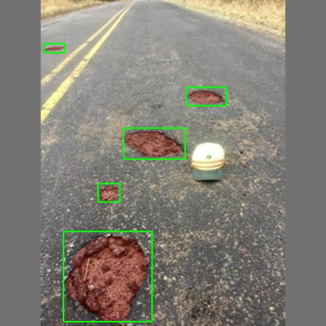
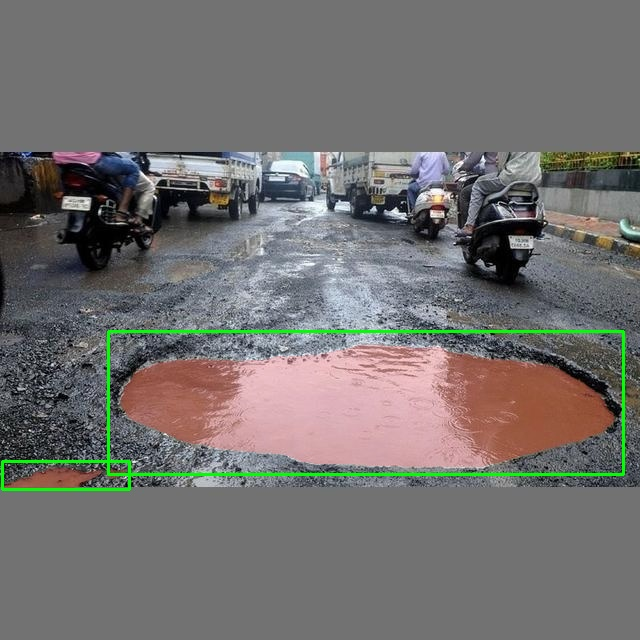
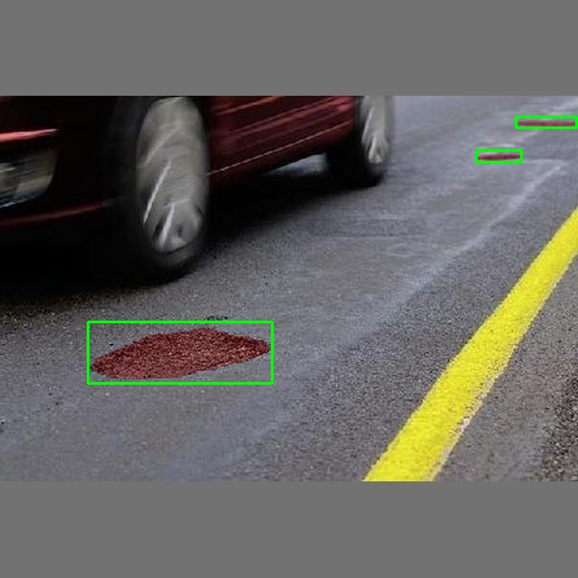
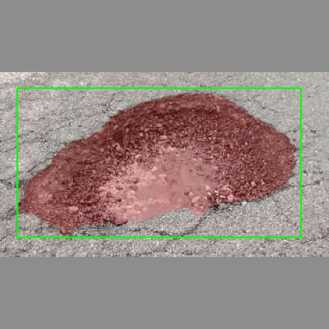
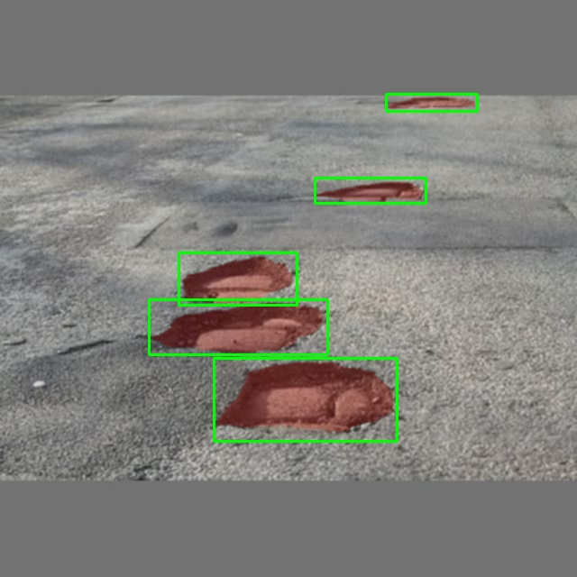
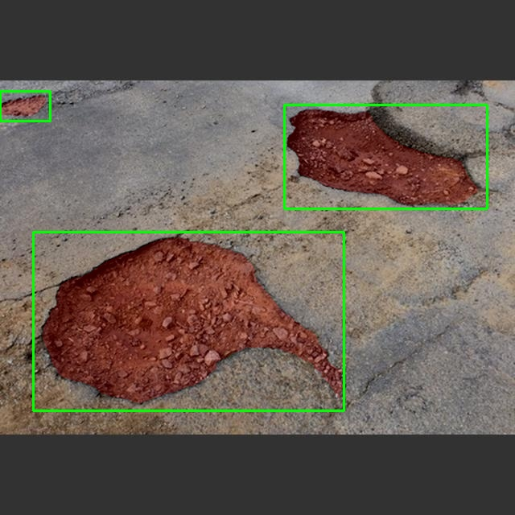
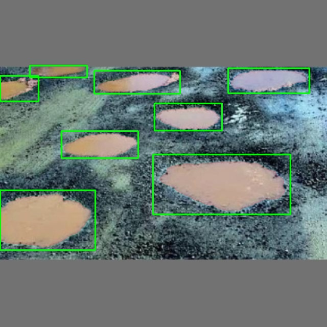
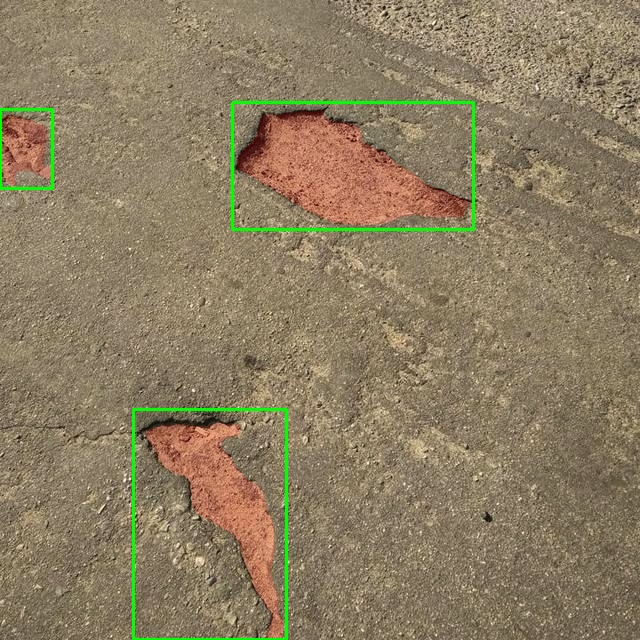
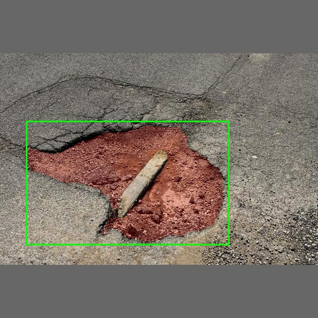
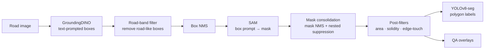

# PaveX Auto-Annotation

**Domain-aware automatic pixel-level annotation of pothole images using GroundingDINO and Segment Anything (SAM), exported in YOLOv8-seg format.**

Drawing polygon masks around irregular road defects by hand is slow and does not scale. This project builds an **inference-only** pipeline that turns raw road images into YOLOv8-seg training labels without manual polygon drawing. It combines pretrained foundation models (no training or fine-tuning) with simple domain-aware rules for road imagery.

<!-- 📄 This repository accompanies the paper "Domain-Aware Automatic Annotation of Pothole Images Using GroundingDINO and Segment Anything". TODO: add journal, link and DOI once available. -->

<p align="center">
  
  
  
  
  
  
  
  
  
</p>
<p align="center"><em>Green: GroundingDINO boxes · Red: SAM masks after filtering</em></p>

---

## Pipeline



| Stage | What it does | Why it exists |
|---|---|---|
| 1. Box proposal | GroundingDINO detects regions matching pothole-related text prompts | Zero-shot localisation, no training needed |
| 2. Road-band filter | Removes boxes that span the image edge to edge, or cover ≥ 75% of it | GroundingDINO often labels the whole road surface as a "pothole" |
| 3. Box NMS | Removes duplicate, strongly overlapping boxes | Avoids redundant SAM prompts |
| 4. Segmentation | Each remaining box is sent to SAM as a box-only prompt | Box prompts give more stable masks than point prompts |
| 5. Consolidation | Mask-level NMS, then nested-mask suppression | Removes duplicate and nested masks |
| 6. Post-filters | Drops masks that are too small, too large, low-solidity, or large and border-touching | Rejects geometrically implausible regions |
| 7. Export | Largest contour → Douglas–Peucker simplification → normalised YOLOv8-seg label | Direct input for YOLOv8-seg training |

### Configuration (paper, Table 2)

| Parameter | Value | Parameter | Value |
|---|---|---|---|
| Text query | `potholes. . pothole. . road pothole. . asphalt hole.` | Mask NMS IoU | 0.70 |
| `BOX_THR` | 0.24 | Nested suppression | containment ≥ 0.90, area ratio ≤ 0.70 |
| Box `NMS_THR` | 0.33 | Min mask area | 200 px |
| Edge margin | 2% | Max mask area fraction | 0.50 |
| Road-band min area / height / width | 0.20 / 0.30 / 0.30 | Min solidity | 0.60 |
| Huge-box area | 0.75 | Edge rule (area gate / edges) | 0.40 / ≥ 3 |
| SAM backbone | ViT-H, one mask per box | Polygon simplification ε | 1.5 px |
| GroundingDINO model | `IDEA-Research/grounding-dino-base` | Min contour area | 10 px |

Notes:
- The four prompts are joined with `" . "`, which gives the exact query shown above. This is kept for comparability with the original experiments.
- Boxes are filtered by `BOX_THR` only. `TEXT_THR` appears in the config but is not used for filtering; in the Transformers post-processing it only assigns phrase labels to boxes.
- Ranking rules: box NMS and mask NMS are greedy by GroundingDINO box confidence; in nested suppression the larger mask (by area) is treated as the container; evaluation matching is greedy by decreasing mask IoU.
- Values are read from `configs/pipeline_config.json` and `configs/seed_input.json`. `pipeline_config.json` also contains settings from earlier exploratory pipelines (for example `TOPK`, selective crops, manhole gate, likelihood scoring and refinement) that the notebooks do not use.

---

## Results

Evaluated on an independent, manually annotated **200-image** ground-truth subset (265 potholes). Predictions are scored as exported YOLOv8-seg polygons, rasterised with the same reader as the ground truth, using greedy one-to-one matching at mask IoU ≥ 0.5. Mean IoU and Dice are computed over matched pairs only.

| Config | TP | FP | FN | Precision | Recall | F1 | Mean IoU | Mean Dice |
|---|---|---|---|---|---|---|---|---|
| B0: GroundingDINO + box NMS + SAM | 238 | 277 | 27 | 0.462 | 0.898 | 0.610 | 0.837 | 0.906 |
| B1: + road-band filter | 242 | 140 | 23 | 0.634 | 0.913 | 0.748 | 0.841 | 0.910 |
| B2: + mask NMS + nested suppression | 229 | 122 | 36 | 0.652 | 0.864 | 0.744 | 0.843 | 0.911 |
| **B3: + post-filters (full pipeline)** | **227** | **114** | **38** | **0.666** | **0.857** | **0.749** | **0.845** | **0.912** |

The road-band filter gives the largest gain, halving false positives while slightly raising recall. Mask NMS removes no masks after box NMS, and nested suppression trades true positives for false positives at a similar rate. Full outputs, per-instance CSVs, figures, the false-positive analysis and provenance (commit, config and code hashes) are in [`results/baseline_ablation/`](results/baseline_ablation/).

> **Note on earlier numbers.** An earlier version of this README reported TP 241 / FP 131 / FN 24 (precision 0.648, recall 0.909). Those results came from a code version in which the nested-suppression rule never fired. They are reproduced exactly when that rule is disabled and raw masks are scored.

---

## Repository structure

```
pavex-autoannotation/
├── README.md
├── LICENSE
├── requirements.txt                  # locked versions
├── notebooks/
│   ├── fullexportrun.ipynb           # full pipeline: config → models → auto-annotate → evaluate
│   ├── baseline_ablation.ipynb       # B0–B3 cumulative ablation (cached GroundingDINO + SAM outputs)
│   └── b3_fp_analysis.ipynb          # contact sheets and tagging of B3 false positives
├── configs/
│   ├── pipeline_config.json          # model IDs, prompts, thresholds, post-filters
│   ├── seed_input.json               # post-filter overrides (min area, max area, solidity)
│   └── paths.example.json            # template for your local paths
├── results/
│   ├── README.md
│   ├── seg_eval_summary.json         # earlier run (superseded, kept for reference)
│   └── baseline_ablation/            # current results: B0–B3, figures, FP analysis
└── docs/images/                      # example overlays
```

Data and model weights are **not** stored in this repository.

---

## Getting started

### 1. Download the model weights

- **SAM ViT-H:** [`sam_vit_h_4b8939.pth`](https://dl.fbaipublicfiles.com/segment_anything/sam_vit_h_4b8939.pth) (~2.4 GB) from [Meta's Segment Anything repository](https://github.com/facebookresearch/segment-anything).
- **GroundingDINO** (`IDEA-Research/grounding-dino-base`) downloads automatically from Hugging Face on first run.

### 2a. Run on Google Colab (GPU recommended)

1. Open `notebooks/fullexportrun.ipynb` in Colab and select **Runtime → Change runtime type → T4 GPU**.
2. Place the config files, SAM weights, images and ground-truth labels on Google Drive, and set the folders in the **Colab section of Cell 0**.
3. Run all cells. Dependencies install automatically.

### 2b. Run locally (Windows, Python 3.12)

```bat
py -V:3.12 -m venv .venv
.venv\Scripts\python.exe -m pip install -r requirements.txt ipykernel
```

1. Copy `configs/paths.example.json` to `configs/paths.local.json` and set your folders. The default layout keeps the data next to the repository:
   ```
   PaveX/
   ├── pavex-autoannotation/     ← this repository
   └── pavex-data/
       ├── images/               images to auto-annotate
       ├── originals/            original images for evaluation (img_XXXX.jpg)
       ├── labels_gt/            ground-truth YOLOv8-seg labels
       ├── models/               sam_vit_h_4b8939.pth
       └── runs/                 created by the notebook
   ```
2. Open the notebook in VS Code, select the `.venv` kernel and run all cells.

Without an NVIDIA GPU, set `MAX_IMAGES = 5` in Cell 0 for a quick test.

### 3. Reproduce the ablation

Open `notebooks/baseline_ablation.ipynb`, which uses the same path settings. It runs GroundingDINO and SAM once per image, caches the outputs, checks on five images that the cached path reproduces the full pipeline exactly, and then evaluates B0–B3. Set `N_IMAGES = None` for the full 200-image run, or a small number for a quick test.

### Run settings (`fullexportrun.ipynb`, Cell 0)

| Setting | Purpose |
|---|---|
| `RUN_ANNOTATE` | Auto-annotate every image in `images_dir` |
| `RUN_EVAL` | Evaluate on the ground-truth subset |
| `MAX_IMAGES` | Limit the number of images (e.g. `5` for a test); `None` = all |
| `SKIP_EXISTING` | Resume an interrupted run (set `RUN_NAME` to that run's folder) |

### Outputs

Each run gets its own folder, `runs/run_<timestamp>/`:

| Output | Contents |
|---|---|
| `labels_pred_seg/` | YOLOv8-seg labels (`cls x1 y1 … xn yn`), one `.txt` per image |
| `overlays_all_seg/`, `overlays_seg_eval/` | QA overlays |
| `eval/` | `seg_eval_summary.json` and `seg_eval_per_image.csv` |
| `pipeline_config.json`, `seed_input.json`, `run_info.json` | Configuration and environment used for the run |

---

## Environment and hardware

| Item | Details |
|---|---|
| Software | Python 3.12 (3.12.12 on Colab, 3.12.10 locally), PyTorch 2.8.0 (CUDA 12.6 build on Colab), torchvision 0.23.0, Transformers 4.57.1, segment-anything 1.0, OpenCV 4.10.0; see `requirements.txt` |
| Full annotation run and evaluation | Google Colab, NVIDIA Tesla T4 (16 GB); about 3.5 s per image |
| Ablation (B0–B3) | Local CPU (the full pipeline takes about 50 s per image on CPU) |

Re-runs on different hardware or library versions may differ slightly in exact counts because of GPU non-determinism.

---

## Dataset

Images were collected from 14 public Kaggle datasets (11,759 raw images) and cleaned by removing sequential dashcam frames, perceptual-hash near-duplicates, blurred images (Laplacian variance < 100) and irrelevant scenes, leaving **2,366 images**.

Images are **not redistributed** here. Each source has its own licence; please obtain them from the original pages:

[1](https://www.kaggle.com/datasets/atulyakumar98/pothole-detection-dataset) ·
[2](https://www.kaggle.com/datasets/andrewmvd/pothole-detection) ·
[3](https://www.kaggle.com/datasets/virenbr11/pothole-and-plain-rode-images) ·
[4](https://www.kaggle.com/datasets/sachinpatel21/pothole-image-dataset) ·
[5](https://www.kaggle.com/datasets/idanbaru/annotated-potholes-with-severity-levels) ·
[6](https://www.kaggle.com/datasets/ashishkumarak/test-zip) ·
[7](https://www.kaggle.com/datasets/virenbr11/pothole-detection-small) ·
[8](https://www.kaggle.com/datasets/jiahangli617/udtiri) ·
[9](https://www.kaggle.com/datasets/hosen42/pothole-data) ·
[10](https://www.kaggle.com/code/satyaprakashshukl/pothole-detection/input) ·
[11](https://www.kaggle.com/datasets/gauravduttakiit/pothole-detection) ·
[12](https://www.kaggle.com/datasets/sovitrath/road-pothole-images-for-pothole-detection) ·
[13](https://www.kaggle.com/datasets/banilkumar20phd7071/pothole-and-normal-road-pavement-augmented-data) ·
[14](https://www.kaggle.com/datasets/gauravduttakiit/pothole-detection-using-ml)

Ground-truth annotations are available from the authors on reasonable request.

---

## Built with

[GroundingDINO](https://github.com/IDEA-Research/GroundingDINO) (via 🤗 Transformers) ·
[Segment Anything](https://github.com/facebookresearch/segment-anything) ·
[OpenCV](https://opencv.org/) ·
[Ultralytics YOLOv8](https://github.com/ultralytics/ultralytics) (downstream training)

<!-- ## Authors

NM Salleh, Yun Xi Ang, Wen Lin Ching, Joey Zhu Yi Ng, Rui Xi Koh, Jia Yin Lim, Yi Ning Tee
Sunway Business School, Sunway University, Malaysia

## Citation

TODO: add the citation once the paper is published.
Title: Domain-Aware Automatic Annotation of Pothole Images Using GroundingDINO and Segment Anything -->

## License

Code is released under the [Apache License 2.0](LICENSE). Model weights and datasets are subject to their original licences.
